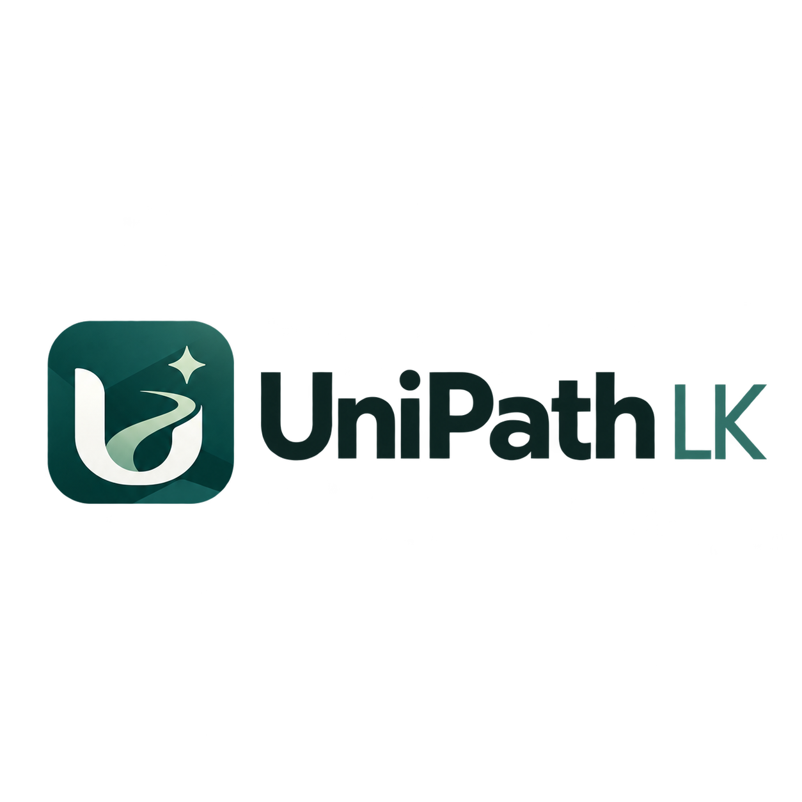

<p align="center">
  
</p>

# UniPath LK

**Every path after A/Ls — checked, costed, and honest.**

### [▶ Try the live demo](https://preview-jac-sbx-0c560a8507fb4a2b937c4cb4dcaca9b9.jachammer.app/)

UniPath LK helps Sri Lankan students who have just finished their A/Ls compare realistic next steps in **12 fields**, from IT and engineering to tourism, law and agriculture. It weighs each route against the student's actual results, savings, monthly budget, location and study preferences. It also shows clearly what is still unknown.

> UniPath LK is a hackathon prototype with a small, researched catalogue (37 real programmes from seven providers). It is not a national directory and never makes an admission decision.

---

## What you can do

- **Explore pathways.** Enter your A/L stream, results and budget, then get up to three routes that the server has checked against your profile. Each route shows its conditions, sources and cash-flow picture.
- **Compare routes side by side**, including cost, duration, entry status and what still needs confirming.
- **See how the plan was made.** The planning activity shows each step the agent took and why: inspecting routes, stress-testing a budget, exploring a "what-if" or asking you the one question that matters most.
- **Answer the planner's questions.** It asks about the missing detail that would change the most routes, then continues the same plan without asking you twice.
- **Stress-test your budget** with a scenario of +40% travel cost and a six-month delay.
- **Consider retaking your A/Ls.** Compare the preparation time and cost, and the income you'd give up, with the routes available to you now.
- **Chat with the UniPath AI agent.** Ask about courses, entry rules, costs or retakes. The agent reads each programme's evidence, tells you what to check first and can open the right tool for you.

## How it stays honest

- **Server-owned facts.** Fees, requirements, sources and programme IDs come only from the researched catalogue. Gemini can choose actions and allowlisted codes, but it can't invent facts, costs or admission outcomes.
- **Unknown is never zero.** Missing fees or requirements stay visibly "Not confirmed" and are never treated as free or as passed.
- **What-ifs are labelled.** A route that would open only under a different assumption, such as moving to the campus, is shown separately and never changes your real results.
- **Privacy by design.** Nothing is saved, and you don't need an account. Gemini never receives your savings, budget, district or grades.
- **Rules first.** If AI is off or unavailable, the same checks run on deterministic rules, and the app says so.

## Built with

- **[Jac](https://docs.jaseci.org) 0.34.23:** the graph and rule engine, walkers and native client UI in one language.
- **byLLM with Gemini:** optional, bounded AI planning and the chat agent.
- **Graph search:** programmes are nodes and progressions are edges with their own prerequisites. Each branch keeps its own state, and search has cycle guards and explicit limits.
- Hosted on **JacHammer**.

## Run it yourself

The project targets Jac 0.34.23, which is available as a prebuilt release in JacHammer.

1. Import this repository into [JacHammer](https://jachammer.ai) and choose **Jac 0.34.23** under **Settings > Jac version**.
2. Optional: to enable live AI, add `GOOGLE_API_KEY` under **Settings > Environment variables**.
3. Start the preview.

To run locally with the Jac 0.34.23 CLI:

```bash
jac start main.jac --port 8000
```

Keep API keys in server environment variables only, never in code or commits.

## Testing

```bash
jac test tests/engine_tests.jac
jac run tests/http_regression.jac   # with the server running
```

The engine, planner, guide and retake logic pass 59 native tests on Jac 0.34.23. Those tests cover eligibility, cash-flow figures, cycle and search limits, AI-proposal rejection, privacy and the signed plan state.

**Known limits:**
- Some request-hardening checks from the earlier release are not ported to 0.34 yet.
- Programme coverage is deliberately small.

See [tasks.md](tasks.md) for details.

## Project documents

[Product requirements](prd.md) · [Architecture](architecture.md) · [Agents](agents.md) · [Decisions](decisions.md) · [Catalogue evidence](docs/catalogue-evidence.md) · [Test matrix](docs/test-matrix.md)

---

*Always confirm current entry rules, fees, intakes and recognition with the institution before you commit. UniPath LK helps you ask the right questions; it does not decide for you.*
