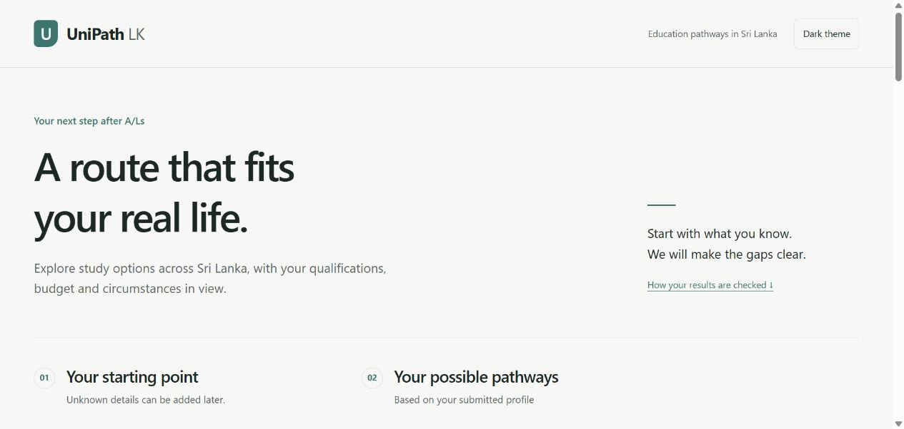

# UniPath LK

UniPath LK helps Sri Lankan post-A/L students explore higher-education routes across 12 fields, compare known requirements, and identify what still needs confirmation. It is a local hackathon prototype built with Jac 0.16.7, byLLM 0.6.19 and Python 3.12.

The real catalogue contains **31 programmes from five institutions**, including business, law, health, engineering, education, arts, languages, science, agriculture and tourism. Every programme has separate source-labelled claims. Programme existence, admission, fees, recognition and progression are assessed separately. The small catalogue is a discovery sample; a missing route is not evidence that no route exists.



*Actual local application view.* [Business results](docs/screenshots/business-results.jpg) · [AI planning activity](docs/screenshots/ai-assisted-activity.jpg) · [Browser QA evidence](docs/browser-qa.md). The [2:30 walkthrough](https://github.com/madukamalruk/unipathlk-v2/blob/main/docs/demo-walkthrough.mp4) is captioned captured views with no audio, not a continuous screen recording.

## Current implementation

- Native Jac `Catalogue` and `Offering` nodes connected by `ProgressesTo` edges. `BranchSearchWalker` searches with isolated branch qualifications, checks progression rules, prunes cycles and reports search limits.
- Deterministic three-valued entry checks: pass, fail or unknown. Whole-route evaluation checks earned qualifications, evidence and monthly cash flow before preference ranking.
- A native Jac client in `components/App.cl.jac`, mounted through `main.jac`. The browser submits the full current profile and revision; plan and stress results are recomputed on the server.
- Editorial goal-tag alignment and confirmed study-mode matching inform ordering after hard route status; unmatched goals remain discovery rather than invented recommendations.
- A bounded, typed byLLM planner chooses `search_alternatives`, `evaluate_candidates`, `ask_student` or `finish`. The model cannot create programmes, change prices, override rules or invent accepted route IDs.
- Claim-level official links and check dates, selectable prior qualifications, explanatory blocked results and a named travel/delay stress scenario.
- One sourced real progression application route: OUSL Diploma in English Language and Literature → OUSL BA English and English Language Teaching. Application and institutional acceptance remain required; no shortened degree or credit transfer is asserted.

Real costs remain unknown because complete current payment and travel schedules are unavailable. Real routes therefore retain confirmation states. The separate, visibly labelled fictional catalogue supplies hand-checkable financial and multi-stage demonstrations.

## Run locally on Windows

Use the project directory and its Python 3.12 virtual environment. If creating a fresh environment:

```powershell
py -3.12 -m venv .venv
.venv\Scripts\python.exe -m pip install -r requirements.txt
```

Start the application with the project-local executable:

```powershell
$env:PYTHONIOENCODING = "utf-8"
.venv\Scripts\jac.exe start main.jac --port 8000
```

Open [the local application](http://127.0.0.1:8000). The native Jac client is the application UI. `index.html` is a legacy entry, not the supported frontend workflow. Keep the server running for browser and HTTP checks.

AI assistance uses server-side `GOOGLE_API_KEY` or `GEMINI_API_KEY`; `UNIPATH_MODEL` can override the configured model. Set credentials privately in the server environment or local settings; never put them in browser code, recordings or commits. With AI disabled, unavailable or unsuccessful, deterministic planning continues and the response identifies its fallback mode. No key is needed for the offline regression suite.

## Verification

Run from the project directory:

```powershell
.venv\Scripts\jac.exe check tests/engine_tests.jac tests/http_regression.jac
.venv\Scripts\jac.exe test tests/engine_tests.jac -v
# With the local application already running in another terminal:
.venv\Scripts\jac.exe run tests/http_regression.jac
```

The preserved-cache-quarantine baseline passed **35 native Jac tests and seven authoritative HTTP checks**. The subsequent planner type-narrowing fix passed the clean checker and all **35 native tests**. All seven authoritative HTTP checks also passed on the latest typing-fix revision (exit 0, `ci-final-http-authoritative.log`). The clean 12-file checker and exact CI-discovery run of 35 native tests passed locally; hosted Linux CI [run #2](https://github.com/madukamalruk/unipathlk-v2/actions/runs/39014838908) passed for source commit `a5ff6d5`. Use `docs/test-matrix.md` for the latest confirmed result. The checker reported zero errors for the test files; inferred-value and loose JSON dictionary warnings remain. These results cover specified behavior, not complete correctness. See [the test matrix](docs/test-matrix.md).

The current local browser journey also showed genuine AI-assisted planning through search, evaluation and a relevant O/L English question, with no fallback label on that captured request. An earlier genuine Gemini smoke request took 4.89 seconds; that separate observation is not a response-time or quality guarantee. Offline tests use AI-disabled requests, scripted decisions or provider-boundary mocks; they make no provider calls.

The fictional financial oracle uses LKR 2,000 savings and LKR 5,000 monthly budget. Its direct route costs LKR 84,000 with a LKR 22,000 initial savings gap. Its Foundation → Diploma → Top-Up route costs LKR 54,000 with zero gap over 12 months, conditional on completing each stage and satisfying relocation. These are invented test figures, not institutional fee quotations.

## Goal and study preference behavior

Goal text is matched against editorial subject-exploration tags on the terminal programme in a route. Matching is case-insensitive, ignores punctuation and requires a complete normalised tag phrase in the supplied goal; it is not semantic career counselling. A match is labelled `related_subject_terms`; an unmatched goal is `not_established` and does not invent or remove routes. An empty goal is `not_supplied`. These search associations do not establish professional qualification, registration, admission or employment.

Deterministic ordering keeps route status first, then related subject terms, then the selected cost/duration/study preference. With `study_fit`, explicitly matching delivery-mode stages rank ahead of unknown modes; an unknown mode is not counted as a confirmed match. Field selection still defines the discovery scope, including general or unmatched goals. No goal term or study preference can override a failed prerequisite, cash-flow condition or evidence gate.

## Runtime compatibility

The project-local `services/compat.jac` hook is restricted to Jac 0.16.7. Its render hook calls the core renderer, repairs the React root ID, includes the extracted stylesheet and adds viewport metadata for this app. It registers through the runtime hook API rather than editing installed packages or generated bundles. Its JSON hook and project-local API-server handler factory replace framework error text with a generic rejection message and remove structured error tracebacks before normal serialization. The handler boundary also covers canonical TransportResponse objects that bypass send_json in this release; it delegates the response exactly once. Successful application reports are left intact. This is a narrow compatibility and error-envelope measure, not a claim that every possible log or exception channel has been audited.

On Windows, set `$env:PYTHONIOENCODING = "utf-8"` before starting Jac directly. The supplied launcher already sets this console encoding.

## Provider transport adapter

The native Jac BoundedGeminiModel subclass uses byLLM 0.6.19’s public make_model_params extension point to set an eight-second SDK transport timeout and zero SDK retries. This is necessary because that release’s nonstreaming parameter construction does not forward timeout/num_retries from call_params. The outer future waits for min(10 seconds, remaining session budget), with a 15-second planning deadline; stream_num_retries and max_output_retries are zero. Installed packages and byLLM’s prompt/schema/response handling remain unchanged.

## API and bounded behavior

Six public walker operations are available under `POST /walker/<name>`: `get_app_info`, `plan_pathways`, `run_stress_test`, `get_catalogue_projection`, `get_evidence` and `health`. Jac responses carry reports in the installed runtime's response envelope. Private helpers are not public operations, and client-calculated results or unsupported fields are rejected.

Search defaults are four stages, 100 states and 20 candidate paths; the response returns up to three candidate and three blocked route cards. Truncation is reported. Planning permits at most four actions, with a 15-second planning deadline and an outer provider wait of at most ten seconds, limited by the remaining deadline. The SDK adapter requests an eight-second transport timeout and zero retries. A process-local limiter permits two concurrent provider calls and 30 calls per minute. These are implementation bounds; load and saturation behavior has not been established by the current tests.

The planner does not attach student profiles to the shared graph. In-memory profile/catalogue isolation is tested. The prototype has no account workflow or saved-profile feature; this is not a forensic audit of runtime logs or storage.

## Status and next work

Core browser QA is complete for the tested local journeys: business/accounting discovery, mobile hospitality layout, dark theme and keyboard interaction, evidence links, the O/L English follow-up and F-grade re-evaluation, unknown-cost stress, fictional financial oracles, and network-error/retry handling. This is a scoped local check, not a claim of every browser, device or accessibility condition. The repository and presentation artifacts are published on GitHub. The planner fix passed clean checking and 35 native tests; all seven authoritative HTTP checks passed on the latest typing-fix revision; hosted Linux CI [run #2](https://github.com/madukamalruk/unipathlk-v2/actions/runs/39014838908) passed for source commit `a5ff6d5`. Hosting is deferred by the user until local review; event submission remains pending. The prepared [2:30 captioned walkthrough](https://github.com/madukamalruk/unipathlk-v2/blob/main/docs/demo-walkthrough.mp4) is assembled from real captured app views with no audio; it is not a continuous screen recording. [Video notes](https://github.com/madukamalruk/unipathlk-v2/blob/main/docs/demo-video-notes.md) document its sources and limits. A six-slide [PDF pitch deck](https://github.com/madukamalruk/unipathlk-v2/blob/main/docs/pitch-deck.pdf), [editable PowerPoint](https://github.com/madukamalruk/unipathlk-v2/blob/main/docs/pitch-deck.pptx) and [preview](https://github.com/madukamalruk/unipathlk-v2/blob/main/docs/pitch-deck-preview.png) have been prepared and visually reviewed. Do not describe the project as production ready or the catalogue as fully verified. Current-intake and professional-recognition checks remain explicit follow-up work. Loans, automatic transfers and job guarantees are not part of the implemented model.

Start with [catalogue evidence](docs/catalogue-evidence.md), [verification matrix](docs/test-matrix.md), [implementation status](IMPLEMENTATION_PLAN.md), [submission draft](SUBMISSION_DOCUMENT.md) and [demo script](DEMO_VIDEO_SCRIPT.md). `tasks.md` is the active completion checklist. Older concept documents may describe superseded features; executable code and the current evidence/status documents determine what can be demonstrated.

## Publication and source measurement snapshot — 17 October 2026

The [public repository](https://github.com/madukamalruk/unipathlk-v2) was published with initial commit [`d2f41e8`](https://github.com/madukamalruk/unipathlk-v2/commit/d2f41e823edb7f940b32d0d3de24ab5d6290fb46). This is the initial publication snapshot; a subsequent planner control-flow fix passed clean checking and 35 native tests, and all seven authoritative HTTP checks on the latest typing-fix revision. Hosting is deferred by the user until local review; final event submission remains pending.

The recorded source snapshot reports Jac **86.191% of nonwhitespace UTF-8 bytes** and **72.892% of nonblank lines** under `scripts/audit_source.jac`. The observed GitHub Languages display reports **Jac 88.3%, CSS 11.0%, Other 0.7%**. These use different denominators. The organiser’s counting method is unconfirmed, so these measurements do not establish unconditional compliance with the ≥80% requirement. Rerun the source audit after code changes.
