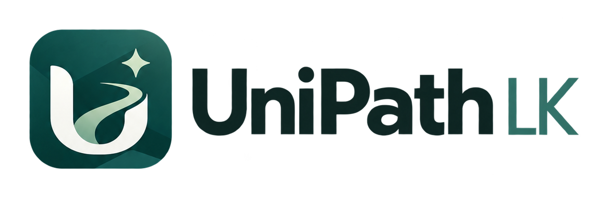
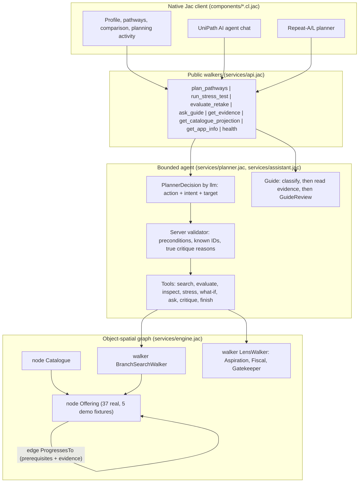

<p align="center">
  
</p>

# UniPath LK 🎓⚡
### Every path after A/Ls — checked, costed, and honest | Built with Jac & byLLM
> **AI Hackathon 2026 Sri Lanka submission (University of Moratuwa & Jaseci Labs)**

### [▶ Try the live demo](https://preview-jac-sbx-0c560a8507fb4a2b937c4cb4dcaca9b9.jachammer.app/)

[](https://docs.jaseci.org)
[](https://docs.jaseci.org)
[](#-verification--running)
[](https://jachammer.ai)

---

## 🌟 Executive Summary

Every year, many Sri Lankan students finish their A/Ls without a state university place, or with results, money, location or family responsibilities that rule out the obvious route. Most guidance tools either list courses with no regard to the student's real situation, or use chatbots that can invent programmes, fees and promises.

**UniPath LK** takes a different approach. Students describe their results, savings, monthly budget, district and study preferences. A **graph-based planning agent** written in **Jac** then searches real programmes and progression routes, and checks each route against the student's profile. It explains what fits, what is blocked and what is still **unknown**.

AI is used where it helps and is never trusted with facts. **Gemini (via byLLM)** decides *which* checks to run, *which* question to ask and *what* to highlight. Every fee, requirement, programme and source comes from a researched, server-owned catalogue. When AI is off or unavailable, the same deterministic checks run on rules, and the app says so.

---

## 🚀 Key Features

* **🌐 Evidence-backed programme graph:** **37 real programmes in 12 fields** from seven providers: OUSL, University of Colombo, Sabaragamuwa University, SLIIT, SLIATE, SLITHM and DTET. Every record carries independent claims (entry, fees, duration, recognition, intake) with a source and a review status. Unknown complete costs stay `null`, never zero.
* **🤖 Agentic planner (`services/planner.jac`):** Gemini picks from a set of server tools, each gated by preconditions:
  * `search_alternatives` / `evaluate_candidates`: graph search and whole-route checks;
  * `inspect_route`: Aspiration, Fiscal, Gatekeeper and Bridge findings for one route;
  * `stress_test`: +40% travel cost and a six-month delay on an affordable route;
  * `explore_variant`: labelled what-ifs, such as "if you could relocate" or "if you also considered another field";
  * `ask_student`: asks for the missing detail that changes the **most** routes;
  * `critique`: a self-check whose reason the server verifies before granting one more step;
  * `finish`.

  The planner has explicit budgets: 8 actions, 20 seconds and capped tool use. An invalid proposal is rejected and the rules finish the plan.
* **🕸️ Graph search (`services/engine.jac`):** `BranchSearchWalker` traverses `Offering` nodes along typed `ProgressesTo` edges. It checks prerequisites on nodes and edges, copies state for each branch and guards against cycles. It is capped at 4 stages, 100 states and 20 candidates, and requirements evaluate to `pass | fail | unknown`.
* **💰 Honest cash flow:** a monthly ledger computes total cost, minimum balance and the exact extra savings needed. The stress test reports **absolute LKR and month changes**, not invented "resilience" percentages.
* **🔁 Resumable plans:** a signed, browser-held `plan_state` lets an answer continue the same plan without repeating questions, with nothing stored on the server.
* **💬 UniPath AI agent:** a chat panel that classifies the question, reads programme evidence, chooses what to check first and can trigger app tools ("Check my pathways", "Open the retake planner").
* **📚 Retake decision aid:** compares another A/L sitting (preparation months, costs and income given up) with the routes available now, citing year-scoped official guidance. It never predicts grades or admission.

---

## 🏗️ System Architecture



---

## 📑 Documentation

| Document | Purpose |
| :--- | :--- |
| 📋 [Product Requirements (PRD)](prd.md) | Audience, approved scope, exclusions and acceptance evidence. |
| 🏛️ [System Architecture](architecture.md) | Graph model, agent loop, AI bounds, public operations and security notes. |
| 🤖 [Agent Contracts](agents.md) | Lens agents, branch search walker, planner and development roles. |
| 🛠️ [Skills & Knowledge](skills.md) | Domain knowledge and working conventions. |
| 📜 [Decisions](decisions.md) | Key design decisions and their reasons. |
| 📝 [Tasks](tasks.md) | Increment history with recorded evidence, including the Jac 0.34.23 port. |
| 🧪 [Test Matrix](docs/test-matrix.md) | What has been verified, how, and what has not. |
| 🔎 [Catalogue Evidence](docs/catalogue-evidence.md) | Sources and review status for programme claims. |
| 📄 [Submission Document](SUBMISSION_DOCUMENT.md) | Hackathon submission write-up. |
| 🎬 [Demo Video Script](DEMO_VIDEO_SCRIPT.md) | Walkthrough script for the demo. |

---

## ⚡ Quickstart

### Option A: Use the live demo
Open the **[live demo](https://preview-jac-sbx-0c560a8507fb4a2b937c4cb4dcaca9b9.jachammer.app/)**. No account is needed and nothing is saved.

### Option B: Run on JacHammer
1. Import this repository into [JacHammer](https://jachammer.ai).
2. Choose **Jac 0.34.23** under **Settings > Jac version**.
3. Optional: to enable live Gemini, add `GOOGLE_API_KEY` under **Settings > Environment variables**.
4. Start the preview.

### Option C: Run locally with the Jac 0.34.23 CLI
```bash
jac start main.jac --port 8000
```
Then open `http://localhost:8000`.

> **API keys:** set `GOOGLE_API_KEY` (or `GEMINI_API_KEY`) only in server environment variables, never in code, screenshots or commits. Without a key, planning and guidance run on deterministic rules and say so.

---

## 🧪 Verification & Running

```bash
# Native behavioural tests
jac test tests/engine_tests.jac

# HTTP regression groups (with the server running)
jac run tests/http_regression.jac
```

Results with the official Jac 0.34.23 binary:

| Check | Result |
| :--- | :--- |
| Type-check of all authored modules | ✅ 17 / 17 |
| Native tests (engine, planner, guide, retake, privacy) | ✅ 59 / 59 |
| HTTP groups H01–H06, H08, H09, H12 | ✅ Passing |
| HTTP H07, H10, H11 (request hardening from the earlier release) | ⚠️ Not yet ported to 0.34 |

The native tests check fixed cash-flow figures, prerequisite and cycle handling, search limits, rejection of invented model output, isolation of what-ifs, impact-ranked questions, tamper-proof plan state, and that Gemini never receives savings, budget, district or grades.

---

## 🏆 Hackathon Alignment

| Criterion | How UniPath LK addresses it |
| :--- | :--- |
| **Jac-first codebase** | Engine, graph, walkers, agent loop, API and UI are all written in Jac (`.jac` / `.cl.jac`). |
| **Agentic depth** | The planner chooses among precondition-gated tools, sees each tool's result, ranks questions by impact, self-checks before finishing and resumes across turns. Every step shows an intent label. |
| **Jac & Jaseci mastery** | Typed `node` / `edge` archetypes, walkers with `spawn` / `visit`, typed `by llm()` decisions with `sem` descriptions, and a native Jac client. |
| **Reliability & safety** | Deterministic checks decide every outcome. AI proposals are validated, budgets are bounded, there's an honest rules fallback, and model prose is never shown as fact. |
| **Real-world Sri Lankan impact** | Real programmes across 12 fields, budget-aware routes in LKR, practical vocational alternatives and a retake decision aid grounded in official guidance. |

---

## ⚠️ Honest Limits

* The catalogue is deliberately small. It is not a national directory and does not make admission decisions.
* Many complete fees and next intakes are unconfirmed in official sources, so they are shown as unknown.
* Some request-hardening from the earlier Jac release is not yet ported to 0.34 (see [tasks.md](tasks.md)).
* Always confirm entry rules, fees, intakes and recognition with the institution before deciding.

---

## 👥 Team
* **Team UniPath LK**, built for the **AI Hackathon 2026 Sri Lanka** (University of Moratuwa & Jaseci Labs).
* **Repository:** [github.com/baasimMKM/uniguide_V4](https://github.com/baasimMKM/uniguide_V4)
* **Live demo:** [JacHammer preview](https://preview-jac-sbx-0c560a8507fb4a2b937c4cb4dcaca9b9.jachammer.app/)
